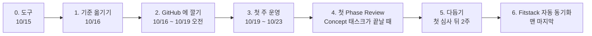

# GitHub NPI 운영 로드맵

> **한 줄 요지:** Fitstack NPI 의 단계·표준 태스크·Phase Review(단계 심사)를 GitHub 의 마일스톤·이슈로 옮겨, **2026-10-19(월)부터 팀이 GitHub 하나만 열고 신규 Dock NPI 일을 하게** 한다. Fitstack 자동 동기화는 GitHub 운영으로 한 단계를 끝까지 돌려 본 뒤 **맨 마지막에** 붙인다. 그때까지 공식 기록은 지금처럼 사람이 Fitstack 게이트에 같은 PDF 와 요약을 올려 맞춘다.

이 문서에 나오는 GitHub 용어를 먼저 풀어 둔다. **이슈**는 할 일 한 건을 담는 카드다. **마일스톤**은 이슈를 묶는 상자이며, 묶인 이슈 가운데 몇 건이 닫혔는지를 진행 막대로 보여 준다. **라벨**은 이슈에 붙이는 색깔 꼬리표로, 꼬리표별로 이슈를 걸러 볼 수 있다. Fitstack 의 무엇이 GitHub 의 어디로 가는지는 [사용 가이드](how-to-work.md)의 첫 표에 있다.

## 지금 어디에 서 있나 (2026-10-16)

기준 내용을 데이터에 옮겼고, 시험과 미리 보기를 처음 실제로 돌려 통과했다. GitHub 에는 아직 아무것도 만들지 않았다.

- **옮긴 것:** 표준 태스크 83개(`npi/tasks.csv`), 단계 5개의 이름과 단계마다의 마일스톤 태스크(★) 18개, Phase Review 규칙, 등급별 시작 단계(`npi/npi.json`). 기준 자료는 `reference/fitstack-npi-reference.md` 이고, 저장소에는 올리지 않는다.
- **기준 자료에 없어서 비워 둔 것:** 단계별 산출물 목록, 태스크별 담당 역할, B급의 시작 단계.
- **확인한 것:** 시험 8개가 통과했고, 그중 하나는 데이터를 기준 자료와 한 줄씩 대조한다. `NPI-A` 미리 보기는 빈 곳 경고 없이 라벨 2개, 마일스톤 5개, 이슈 83개를 만들 계획을 보였다. 자세한 것은 [세션 보고](session-summary.md)에 있다.

그래서 남은 선행 조건은 PM 이 옮긴 내용을 기준 자료와 대조하는 것, 그리고 이 브랜치를 PR 로 올려 머지하는 것(2단계)이다.

## 단계

목표 시점은 제안이다. 각 단계는 앞 단계의 "끝났다는 증거"가 나와야 시작한다.

| 단계 | 목표 시점 | 하는 일 | 끝났다는 증거 | 누가 |
|---|---|---|---|---|
| 0. 도구 | 10/15 (목) | 데이터 틀, 스크립트와 시험, 이슈 양식, 가이드를 만든다 | 이 브랜치의 커밋 `0a7a4b2`, `28e6004` | Claude |
| 1. 기준 옮기기 | 10/16 (금) | 기준 문서를 저장소로 들여와 표준 태스크·통과 조건·심사 규칙·등급을 데이터에 옮기고, 시험과 미리 보기를 처음 돌린다 | 시험이 통과하고, 미리 보기 끝에 "빈 곳" 경고가 하나도 없다 | Claude 가 옮기고 PM 이 기준 문서와 대조한다 |
| 2. GitHub 에 깔기 | 10/16 ~ 10/19 오전 | 이 브랜치를 PR 로 올려 머지하고, PM 이 스크립트를 실제로 실행한다. 기존 안건 이슈 #2~#8 을 `1. Concept` 마일스톤에 넣는다 | Issues 탭의 마일스톤마다 그 단계의 태스크와 Phase Review 이슈가 보인다 | PM |
| 3. 첫 주 운영 | 10/19 (월) ~ 10/23 (금) | 킥오프에서 가이드를 10분 소개하고, Concept 태스크마다 담당자를 정하고, 이미 끝난 태스크는 근거를 달아 닫는다 | 열린 Concept 태스크 전부에 담당자가 있다 | PM·팀 |
| 4. 첫 Phase Review | Concept 태스크가 끝날 때 (날짜 미정) | `Phase Review: 1. Concept` 이슈로 심사·승인하고, 같은 PDF 와 요약을 Fitstack 게이트에 손으로 올린다 | 그 이슈가 승인 댓글과 함께 닫혔고, Fitstack 게이트도 같은 상태다 | PM·심사자 |
| 5. 다듬기 | 첫 심사 뒤 2주 | 운영 중 걸린 점(손으로 옮기기 번거로운 것, 헷갈린 문구)을 모아 데이터와 가이드를 고친다 | 고친 PR 이 머지됐다 | PM·Claude |
| 6. Fitstack 자동 동기화 | 5단계 뒤 (맨 마지막) | 아래 절의 윤곽대로 따로 기획한다 | 심사 이슈가 닫히면 Fitstack 에 사람이 확인할 초안이 자동으로 생긴다 | 사람이 승인한 뒤 |

### 단계마다 조심할 것

- **1단계.** 옮기다가 내용을 지어내지 않도록 스크립트가 기준 숫자와 대조한다. 단계가 5개가 아니거나, 표준 태스크가 83개가 아니거나, 어느 단계에 마일스톤 태스크가 없으면 실제 실행을 거부한다. 4·5단계 이름은 기준 자료로 `Release to Manufacturing`·`Product Launch` 임을 확인했다. 기준의 "마일스톤"은 단계 끝 심사 시점이 아니라 단계 안의 핵심 태스크(★)였고, 각 단계의 마지막 ★ 태스크가 그 단계의 게이트다. 그래서 데이터 형식을 그에 맞게 바꿨다.
- **2단계.** 실제 실행은 GitHub 에 이슈를 한꺼번에 만든다. 등급이 Concept 부터라면 83건이고, 그중 단계마다 마지막 ★ 태스크 5건이 Phase Review 이슈다. 그래서 실행 전에 PM 이 미리 보기를 훑어보고, 저장소 이름을 직접 적어 실행한다(`--apply GeonwooKim-fitogether/smart-dock-npi`). 다시 실행해도 이미 있는 것은 건너뛰므로, 중간에 끊기면 같은 명령을 다시 돌리면 된다. 이슈 양식은 main 에 머지된 뒤에야 GitHub 의 New issue 화면에 나타난다.
- **3단계.** git 을 몰라도 참여할 수 있게 한다. 팀원이 하는 일은 브라우저에서 내 이슈를 찾고, 댓글을 달고, 파일을 끌어다 놓고, 닫는 것이 전부다.
- **4단계.** 이 로드맵의 진짜 시험대다. GitHub 의 심사 결과와 Fitstack 의 공식 기록이 처음으로 나란히 생기므로, 둘을 맞추는 수고가 얼마인지 여기서 잰다. 그 수고가 6단계 설계의 입력이 된다.

## Fitstack 자동 동기화를 맨 뒤에 두는 이유

1. **무엇을 동기화할지는 한 번 돌려 봐야 안다.** 4단계에서 사람이 손으로 옮겨 보면 실제로 반복되는 수고가 드러나고, 자동화는 그것부터 없앤다. 아직 머지되지 않은 운영 틀 초안(브랜치 `docs/working-model`)도 같은 원칙을 적었다.
2. **Fitstack 에 쓰는 일은 실제 운영 데이터베이스를 바꾸는 일이다.** 회사 규칙상 운영 데이터베이스 쓰기는 사람이 그 내용을 보고 승인한 뒤에만 할 수 있고, 먼저 비운영 환경에서 시험해야 한다([데이터베이스 쓰기 규칙](../.claude/rules/db-write-permission.md), [환경 분리 규칙](../.claude/rules/environment-separation.md)).
3. **자동화에는 권한과 비용이 따른다.** GitHub 와 Fitstack 을 잇는 토큰이나 앱 권한은 보안 결정이고, 주기적으로 도는 자동 작업은 유료인 GitHub Actions 사용 시간을 쓴다. 둘 다 사람이 정할 일이다([에스컬레이션 규칙](../.claude/rules/escalation.md) §2).

## 6단계의 윤곽 (기획만 해 두고, 아직 만들지 않는다)

1. **연결 열쇠는 지금 깔아 둔다.** 이슈 제목 앞의 `[태스크 번호]` 는 기준 자료의 표준 태스크 순번(1~83)이다. 단계는 마일스톤 이름 속의 단계명으로 짝짓는다. 기준이 단계를 번호가 아니라 이름으로 식별하라고 정했기 때문이다(등급에 따라 게이트 수가 바뀐다). 마일스톤 이름 앞의 번호는 목록을 단계 순서대로 세우기 위한 고정 순번일 뿐이다. 처음부터 이 형식으로 만들어 두면, 나중에 둘을 짝짓는 표를 따로 만들 필요가 없다.
2. **읽기 전용 내보내기부터 한다.** GitHub 의 단계·태스크·심사 상태를 표 하나로 뽑아 사람이 Fitstack 과 대조한다. 아무것도 쓰지 않으므로 위험이 없고, 4단계의 손 작업도 줄어든다.
3. **비운영 환경에서 쓰기를 시험한다.** Fitstack 의 개발·스테이징 환경에 먼저 반영해 본다.
4. **운영 반영은 결정 카드로 승인받은 뒤에 한다.** 그 뒤에도 게이트를 확정하는 버튼은 계속 사람이 누른다. 자동화는 근거 링크와 초안을 채우는 데까지만 맡는다.

## 정해야 할 것

답이 없으면 아래 기본값대로 진행한다. 기본값은 모두 지금의 원칙을 바꾸지 않는 쪽으로 골랐다.

| 질문 | 답이 없을 때의 기본값 | 언제까지 |
|---|---|---|
| 1~5단계 동안 단계 통과의 공식 기록은 어디인가 | 지금처럼 Fitstack 이다. GitHub 은 일하고 심사하는 자리이고, 통과 결과는 PM 이 Fitstack 에 손으로 옮긴다(`CLAUDE.md` 와 README 의 현재 원칙) | 10/19 킥오프 |
| 이 프로젝트의 등급 | 성공 기준 v2 에 적힌 `NPI-A`. CEO 브리프의 "NPI-A · 게이트 5개"에 따라 Concept 부터 만든다 | 2단계 실행 전 |
| GitHub 에서 누가 Phase Review 승인 댓글을 다는가 | 기준 자료의 Phase Review 규칙에는 심사자가 정해져 있지 않다(10/16 확인). 그래서 PM 이다 | 2단계 실행 전 |
| 운영 틀 초안(브랜치 `docs/working-model`)과의 관계 | 둘 다 살린다. 초안은 도구별 역할과 정본 자리를 맡고, 이 로드맵과 가이드는 NPI 실행 절차를 맡는다. 초안의 "라벨·마일스톤 만들기" 준비 항목은 이 스크립트가 대신한다 | 다음 미팅 |

## 관련 문서

- [사용 가이드](how-to-work.md): 팀원과 PM 이 매일·매주·단계 끝에 하는 일
- [`npi/`](../npi/): 기준 데이터와 스크립트
- [세션 보고](session-summary.md): 1단계에서 무엇을 옮겼고 무엇을 확인했나
