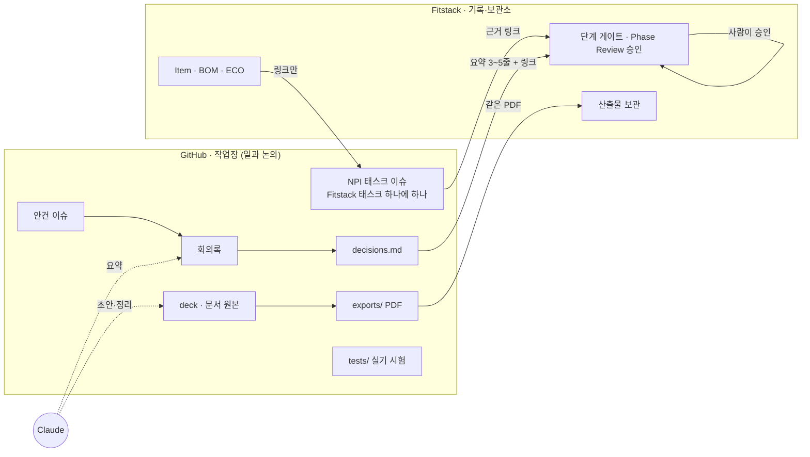
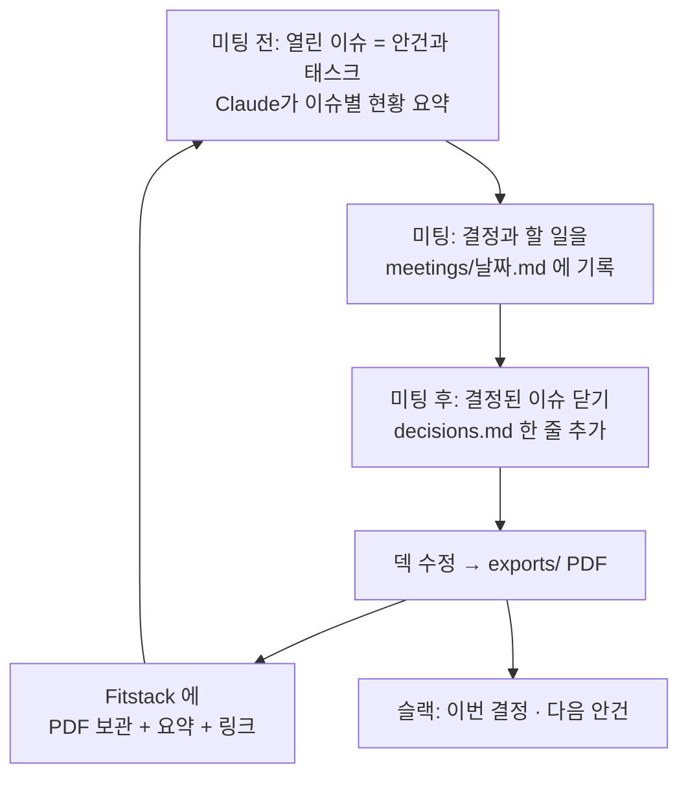

# 운영 틀 v0.2 — GitHub · Fitstack · Claude 를 하나의 작업 환경으로 쓰는 법

> **한 줄 요지:** **일과 논의는 GitHub 에서만 한다**(이슈·PR·산출물). **Fitstack 은 기록·보관소**다 — 산출물의 확정본, 단계 게이트, Phase Review 승인이 그곳에 남고, 부품·BOM·ECO 의 정본도 계속 Fitstack 에 있다. GitHub 이슈는 안건만 담는 곳이 아니라 **Fitstack NPI 태스크 하나에 하나씩** 있다. 같은 내용을 두 곳에서 고치지 않고, **원본은 한 곳에 두고 다른 곳에는 링크만 둔다.** 결정과 승인은 언제나 사람이 한다.

이 문서는 팀원을 초대하기 전에 정하는 **기획안 v0.2** 다. 첫 단계 게이트를 이 방식으로 넘겨 본 뒤 고친다.

**v0.1 에서 바뀐 것 (2026-10-16)**

- GitHub 은 논의만 하는 앞단이 아니라 **일과 논의가 일어나는 유일한 곳**이고, Fitstack 은 **기록·보관소**다(1·2절).
- 이슈는 안건만이 아니다. **Fitstack NPI 태스크 하나에 이슈 하나**이고, 등급별 태스크(A 34 · B 16 · C 5)를 스크립트가 미리 깐다(2·4절).
- 마일스톤은 Fitstack 등급별 태스크 세트의 단계와 같다. 이름은 `RTM` 이 아니라 `Release to Manufacturing` 이고, 등급이 거치는 단계만 만든다(4절).
- Fitstack 자동 동기화는 손 연결로 한 단계를 끝까지 돌려 본 뒤 **맨 마지막에** 붙인다(6절).
- 준비 항목에서 저장소 비공개 전환을 뺐다. 저장소는 의도적으로 공개로 둔다. 라벨·마일스톤·이슈 양식 항목은 지금 구조에 맞췄다(7절).

---

## 1. 세 도구가 맡는 일

| 도구 | 역할 | 여기서 하는 것 | 여기서 하지 않는 것 |
|---|---|---|---|
| **GitHub** `smart-dock-npi` | 작업장 — 일과 논의가 일어나는 유일한 곳 | NPI 태스크 이슈(Fitstack 태스크 하나에 하나), 안건 이슈, 덱·문서·목업 원본(PR), 회의록, 결정 기록, 실기 시험 데이터, 산출물 만들기 | 단계 게이트 통과, Phase Review 승인, 부품·BOM·ECO 의 정본 |
| **Fitstack** (사내 PLM) | 기록·보관소 | 산출물 확정본 보관, NPI 단계 게이트, Phase Review 승인, 부품(Item)·BOM·Change(ECO)·스펙 | 논의, 진행 중인 일, 문서 편집 |
| **Claude** | 실무 보조 | 덱·문서·목업 만들기, 회의록·이슈 요약, 기술 감수, PDF, 게이트에 올릴 근거 모으기 | 결정, Phase Review 승인, 외부 게시, 라이브 DB 쓰기 |

**일은 GitHub 에서 하고, 기록은 Fitstack 에 남긴다.** 태스크의 진행과 논의, 산출물 작성은 모두 GitHub 의 이슈와 PR 에서 일어난다. 한 단계가 끝나면 그 결과(확정본 PDF, 결정 요약, 이슈 링크)를 Fitstack 에 올려 보관하고, 단계 통과는 Fitstack 의 Phase Review 승인으로 기록된다. 설계가 굳는 Development 단계부터 생기는 부품 번호·BOM·회로 변경(ECO)은 처음부터 Fitstack 에 등록하는 정본이다. 그것을 두고 하는 논의는 GitHub 이슈에서 하고, 이슈에는 Fitstack 링크만 남긴다.

---

## 2. 원본은 어디에 — 정보별 정본 표

같은 정보를 두 곳에서 고치면 언젠가 어긋난다. 그래서 정보마다 **정본(원본) 자리를 하나로** 정한다.

| 정보 | 정본 | 다른 곳에는 |
|---|---|---|
| NPI 태스크의 진행·논의 | GitHub 이슈 `[태스크 번호] 제목` (Fitstack 태스크 하나에 하나) | Fitstack 의 같은 번호 태스크에 결과 링크 |
| 진행 중인 안건과 의견 | GitHub 이슈 | 슬랙에는 링크만 |
| 미팅 기록 | GitHub `meetings/날짜.md` | — |
| 확정된 결정 | GitHub `decisions.md` | Fitstack 게이트에 3~5줄 요약 + 링크 |
| 기획 덱·문서·목업 | GitHub `deck/` `mockups/` | — |
| 산출물의 확정본 (PDF) | **Fitstack** 에 보관 | 만드는 곳은 GitHub `exports/` (**같은 파일**) |
| 실기 시험 원자료 | GitHub `tests/` | 결론만 해당 이슈 댓글 |
| NPI 단계 게이트 통과, Phase Review 승인 | **Fitstack** | GitHub 마일스톤은 단계 이름만 맞춘다. 심사 이슈는 두지 않는다 |
| 부품 번호·BOM·스펙·회로 변경(ECO) | **Fitstack** | GitHub 에는 링크만 (사본 금지) |
| 펌웨어 코드 | 각 펌웨어 저장소 | Fitstack Change 가 커밋을 읽어 감 (기존 기능) |

---

## 3. 사람과 권한

Fitstack 의 팀 역할 7종(PM · HW · FW · ME · QA · PROD · SCM)을 그대로 쓴다. GitHub 에서는 같은 이름의 `역할:` 라벨이 태스크 이슈마다 붙는다.

| 역할 | GitHub 권한 | 주로 하는 일 | Fitstack |
|---|---|---|---|
| **PM** (오너) | Admin | 안건 열기·닫기, 미팅 진행, PR 머지, 태스크 이슈 깔기, 단계 끝 근거 정리 | 게이트 담당자, 산출물 보관, Phase Review 요청 |
| **HW · FW · ME** (엔지니어) | Write | 자기 역할의 태스크 이슈, 실기 시험 결과, 자기 영역 문서 PR | 부품·BOM·ECO 등록 (정본) |
| **QA · PROD · SCM** (품질·생산·구매) | Write | 자기 역할의 태스크 이슈 (시험·인증, 파일럿·EMS, 발주) | 시험 결과·인증서·발주서 같은 기록 등록 |
| 그 밖의 검토자 | Triage 또는 Read | 이슈 의견, 리뷰 | 해당 게이트 검토 |

- **git 을 몰라도 참여할 수 있게 한다.** 팀원의 기본 참여 방식은 브라우저에서 **이슈에 댓글**과 **파일 끌어다 놓기**다. 문서 수정이 필요하면 GitHub 웹 편집(연필 버튼)이 자동으로 PR 을 만든다.
- **머지는 PM 이 한다.** 작업장이라도 기록이 남는 곳이라, 한 사람이 최종 정리를 맡는다.

---

## 4. 일하는 리듬

### 상시
- **NPI 태스크는 이미 이슈로 깔려 있다.** Fitstack NPI 태스크 하나에 이슈 하나다(제목 `[태스크 번호] 제목`, 라벨 `NPI 태스크` 와 `역할:`). 진행은 댓글로, 산출물은 첨부나 PR 로 남기고, 끝나면 근거를 달아 닫는다.
- 새 논점이 생기면 **안건 이슈 하나**를 연다. 양식 없는 빈 이슈이고 `NPI 태스크` 라벨은 붙이지 않는다. 의견은 댓글로.
- 자료가 바뀌면 **PR 하나**로 올린다. PR 제목은 `<종류>: <한 문장>` (`.claude/rules/branch-pr-naming.md`).

### 미팅 한 사이클

### 단계 끝 — 게이트 시점
1. 그 단계 마일스톤의 이슈가 모두 닫혔는지 본다. 해당 없는 태스크는 Close as not planned 로 닫는다.
2. Claude 가 이슈별 근거(결정 줄, PDF, 시험 결과, 이슈 링크)를 모아 **게이트 패킷 초안**을 만든다.
3. PM 과 담당자가 검토하고, 같은 PDF 와 요약을 Fitstack 의 같은 번호 태스크와 게이트에 올린다.
4. **Fitstack 에서 사람이 Phase Review 를 승인해 게이트를 넘긴다.** GitHub 에는 심사 이슈를 두지 않는다.
5. 통과하면 GitHub 의 그 마일스톤을 닫는다.

### 마일스톤 = Fitstack 등급별 태스크 세트의 단계

GitHub 마일스톤은 Fitstack NPI 의 단계와 같다 — `1. Concept`, `2. Planning`, `3. Development`, `4. Release to Manufacturing`, `5. Launch`. 프로젝트 등급이 거치는 단계만 만들고, 등급에 깔리는 태스크만 이슈로 만든다.

| 등급 | 마일스톤 | 태스크 이슈 |
|---|---|---|
| NPI-A 신규 플랫폼 | 1 · 2 · 3 · 4 · 5 | 34 |
| NPI-B 파생 개발 | 1 · 3 · 4 | 16 |
| NPI-C 변형 SKU | 3 · 4 | 5 |

앞 번호는 등급과 관계없는 고정 순번이다. 태스크의 원래 단계가 그 등급에 없으면 등급의 첫 단계로 내려온다(Fitstack 과 같은 규칙). 이 프로젝트의 기본값은 성공 기준 v2 의 `NPI-A` 다. 이슈와 마일스톤은 `npi/npi_github.py` 가 만들고, 절차는 [사용 가이드](how-to-work.md)에 있다.

---

## 5. Claude 를 쓰는 규칙

### 진입점
| 누가 | 어디서 | 무엇을 |
|---|---|---|
| PM·문서 담당 | **Claude Code** 로 이 저장소를 연다 | 덱·문서 수정, PDF, 회의록 정리, 이슈 정리, 게이트 패킷 |
| 팀원 | Claude 앱 (필요하면 GitHub·슬랙 연결) | 자료 읽고 질문, 이슈 요약, 의견 초안 |

이 저장소를 연 Claude 세션은 시작할 때 `CLAUDE.md` 를 읽고, 거기 적힌 순서대로 README·결정 기록·최근 회의록·이 문서를 이어 받는다. **누가 어떤 세션을 열어도 같은 방식으로 일하게 만드는 장치가 이 파일들이다.**

### 자주 쓰는 요청 (예시 문구)
- "9/30 회의 메모 붙여 줄게, `meetings/` 에 회의록으로 정리하고 결정은 `decisions.md` 초안으로 만들어 줘"
- "이슈 #2 지금까지 논의 요약해서 댓글로 달아 줘"
- "덱 7쪽에 안 5 추가하고 PDF 새로 뽑아 줘"
- "Concept 게이트 패킷 만들어 줘"
- "이 회로 변경안 KEE 로 감수해 줘"

반복해서 쓰게 되는 요청은 슬래시 커맨드로 만들 수 있다. 단 커맨드·스킬·규칙은 **회사 템플릿 창고에서 만든다**(`.claude/rules/upstream-first.md`) — 이 저장소에서 만들면 동기화 때 사라진다.

### Claude 가 하지 않는 것
- **결정과 승인:** `decisions.md` 에는 미팅에서 정해진 것만 쓰고, Phase Review 승인과 게이트 확정은 Fitstack 에서 사람이 한다.
- **외부 게시:** 슬랙 전송, 저장소 공개 범위 변경, 팀원 초대는 사람이 한다(초안은 Claude 가 만든다).
- **Fitstack 데이터 직접 쓰기:** 라이브 DB 쓰기는 Fitstack 저장소의 승인 절차를 따른다.
- **결과물을 대화창에만 두기:** Claude 가 만든 것은 반드시 파일(PR)이나 이슈 댓글로 남긴다. 각자의 대화창에 흩어지면 사람의 메모가 흩어지는 것과 같은 문제가 생긴다.

---

## 6. Fitstack 과의 연결 — 지금은 손으로, 자동 동기화는 맨 마지막

| 순서 | 연결 방식 | 언제 |
|---|---|---|
| **1. 손 연결 (지금)** | 이슈 제목 앞의 `[태스크 번호]` 가 Fitstack NPI 태스크 번호와 같다. 단계 끝에 사람이 근거 링크와 `exports/` PDF 를 Fitstack 태스크와 게이트에 올리고, Fitstack 에서 Phase Review 를 승인한다 | 이 문서로 시작 |
| 2. GitHub 쪽 깔기 | `npi/npi_github.py` 가 등급별 태스크를 이슈로, 단계를 마일스톤으로 만든다. GitHub 만 바꾸고 Fitstack 은 건드리지 않는다 | 준비됨 (실행은 PM) |
| 3. 읽기 전용 대조 | GitHub 의 단계·태스크 상태를 표로 뽑아 사람이 Fitstack 과 대조한다. 아무것도 쓰지 않는다 | 첫 게이트를 손으로 넘긴 뒤 |
| **4. 자동 동기화 (맨 마지막)** | Fitstack 프로젝트에 GitHub 저장소 칸을 두고, 이슈 닫힘·PDF 커밋을 Fitstack 태스크에 링크·초안으로 자동 첨부한다. 비운영 환경에서 먼저 시험하고, 조직 GitHub 앱·토큰과 운영 반영은 사람이 승인한다. Phase Review 승인은 그 뒤에도 사람이 한다 | 손 연결로 한 단계를 끝까지 넘겨 본 뒤 |

손 연결로 한 단계를 끝까지 넘겨 보고 "손으로 옮기기 귀찮은 것"이 무엇인지 확인한 뒤에 자동화를 기획한다. 자동화는 실제로 반복된 수고를 없애는 것부터 한다. Fitstack 에 쓰는 자동화는 운영 데이터베이스를 바꾸는 일이고 권한과 비용이 따르므로, 맨 마지막에 사람의 승인을 받아 붙인다. 이유와 일정은 [로드맵](roadmap.md)에 있다.

---

## 7. 팀원 초대 전 준비 (체크리스트)

- [ ] **라벨·마일스톤·태스크 이슈 깔기** — `npi/npi_github.py` 의 미리 보기를 확인한 뒤 PM 이 `--apply` 로 만든다. 라벨은 `NPI 태스크` 와 `역할:PM` · `HW` · `FW` · `ME` · `QA` · `PROD` · `SCM`, 마일스톤은 등급이 거치는 단계, 이슈는 등급별 태스크(NPI-A 면 34건)다. 기존 이슈 #2~#8 은 `1. Concept` 에 배정한다
- [ ] **이슈 양식** — `NPI 태스크 (표준 외 추가)` (`.github/ISSUE_TEMPLATE/npi-task.yml`). 등급별 태스크에 없는 일과 83개 라이브러리(`npi/task-library.csv`)에서 고른 태스크를 더할 때 쓴다. 안건은 양식 없이 연다
- [ ] 머지된 브랜치 자동 삭제 켜기 (Settings → General)
- [ ] (선택) 슬랙 채널에 GitHub 알림 연결 — 새 이슈·PR 만 알림
- [ ] 팀원별 GitHub 계정과 역할(PM · HW · FW · ME · QA · PROD · SCM) 명단 — 태스크 이슈의 담당자 배정에 쓴다
- [ ] 이 문서를 첫 미팅에서 10분 소개

라벨·마일스톤·이슈는 스크립트가 만들고, 실행은 PM 이 한다. 초대·슬랙 연결은 사람이 한다.

---

## 8. 정해야 할 것

1. **팀원 명단과 역할** — 7역할 중 누가 무엇을 맡고, 누가 Write 이고 누가 Read 인가
2. **미팅 주기** — 주 1회 / 격주
3. **팀원의 Claude 사용 범위** — PM 만 쓸지, 팀원도 쓸지 (계정·비용)
4. **슬랙 알림 연동 여부와 채널**
5. **이 프로젝트의 등급과 인증 필요 여부** — 기본값은 `NPI-A`, 인증 필요([로드맵](roadmap.md)의 "정해야 할 것")
6. **이 문서 v0.2 승인** — 첫 단계 게이트를 넘긴 뒤 v0.3 으로 고친다
