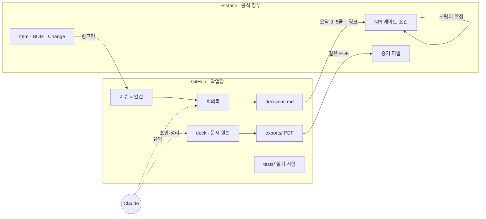
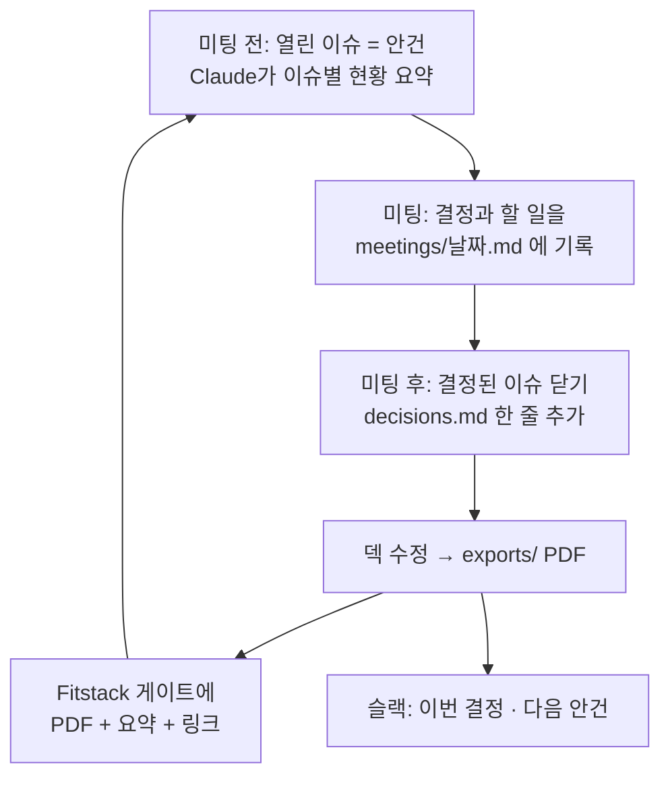

# 운영 틀 — GitHub · Fitstack · Claude 를 하나의 작업 환경으로 쓰는 법

> **한 줄 요지:** GitHub 은 **작업장**(자료·논의·변경 이력), Fitstack 은 **공식 장부**(단계·게이트·확정·양산 데이터), Claude 는 **실무 보조**(초안·정리·검토)다. 같은 내용을 두 곳에 쓰지 않고, **원본은 한 곳에 두고 다른 곳에는 링크만 둔다.** 결정과 확정은 언제나 사람이 한다.

이 문서는 팀원을 초대하기 전에 정하는 **기획안(v0.1)** 이다. 첫 미팅 사이클을 이 방식으로 돌려 본 뒤 고친다.

---

## 1. 세 도구가 맡는 일

| 도구 | 역할 | 여기서만 하는 것 | 여기서 하지 않는 것 |
|---|---|---|---|
| **GitHub** `smart-dock-npi` | 작업장 | 안건 논의(이슈), 덱·문서·목업 원본, 회의록, 결정 기록, 실기 시험 데이터 | 게이트 확정, 부품·BOM·스펙의 정본 |
| **Fitstack** (사내 PLM) | 공식 장부 | NPI 단계·게이트 통과, 증거 보관, 부품(Item)·BOM·Change(ECO)·스펙 | 진행 중인 논의, 문서 편집 |
| **Claude** | 실무 보조 | 덱·문서·목업 만들기, 회의록·이슈 요약, 기술 감수, PDF | 결정, 게이트 확정, 외부 게시, 라이브 DB 쓰기 |

**단계가 진행될수록 무게중심이 옮겨 간다.** 지금(Concept·Planning)은 논의가 대부분이라 GitHub 이 주 무대다. 설계가 굳는 Development 단계부터는 부품 번호·BOM·회로 변경(ECO)이 생기고, 그것들의 정본은 처음부터 Fitstack 이다. GitHub 에는 그 링크만 남긴다.

---

## 2. 원본은 어디에 — 정보별 정본 표

같은 정보를 두 곳에서 고치면 언젠가 어긋난다. 그래서 정보마다 **정본(원본) 자리를 하나로** 정한다.

| 정보 | 정본 | 다른 곳에는 |
|---|---|---|
| 진행 중인 안건과 의견 | GitHub 이슈 | 슬랙에는 링크만 |
| 미팅 기록 | GitHub `meetings/날짜.md` | — |
| 확정된 결정 | GitHub `decisions.md` | Fitstack 게이트 "수행 내용"에 3~5줄 요약 + 링크 |
| 기획 덱·문서·목업 | GitHub `deck/` `mockups/` | — |
| 그 시점의 확정본 | GitHub `exports/*.pdf` | Fitstack 게이트 증거 파일 (**같은 파일**) |
| 실기 시험 원자료 | GitHub `tests/` | 결론만 해당 이슈 댓글 |
| NPI 단계·게이트 통과 여부 | **Fitstack** | GitHub 마일스톤은 이름만 맞춤 |
| 부품 번호·BOM·스펙·회로 변경(ECO) | **Fitstack** | GitHub 에는 링크만 (사본 금지) |
| 펌웨어 코드 | 각 펌웨어 저장소 | Fitstack Change 가 커밋을 읽어 감 (기존 기능) |

---

## 3. 사람과 권한

Fitstack 의 팀 역할(PM · HW · FW · ME · QA)을 그대로 쓴다.

| 역할 | GitHub 권한 | 주로 하는 일 | Fitstack |
|---|---|---|---|
| **PM** (오너) | Admin | 안건 열기·닫기, 미팅 진행, PR 머지, 게이트 확정 | 게이트 담당자 |
| **HW · FW · ME** (엔지니어) | Write | 이슈 의견, 실기 시험 결과, 자기 영역 문서 PR | 조건별 근거 제출 |
| **QA · 기타 검토자** | Triage 또는 Read | 이슈 의견, 리뷰 | 해당 게이트 검토 |

- **git 을 몰라도 참여할 수 있게 한다.** 팀원의 기본 참여 방식은 브라우저에서 **이슈에 댓글**과 **파일 끌어다 놓기**다. 문서 수정이 필요하면 GitHub 웹 편집(연필 버튼)이 자동으로 PR 을 만든다.
- **머지는 PM 이 한다.** 작업장이라도 기록이 남는 곳이라, 한 사람이 최종 정리를 맡는다.

---

## 4. 일하는 리듬

### 상시
- 새 논점이 생기면 **이슈 하나**를 연다(라벨 `안건`). 의견은 댓글로.
- 자료가 바뀌면 **PR 하나**로 올린다. PR 제목은 `<종류>: <한 문장>` (`.claude/rules/branch-pr-naming.md`).

### 미팅 한 사이클

### 게이트 시점
1. Claude 가 게이트 조건별로 근거(결정 줄, PDF, 시험 결과, 이슈 링크)를 모아 **게이트 패킷 초안**을 만든다.
2. PM 과 담당자가 검토한다.
3. Fitstack 에서 사람이 조건을 하나씩 **확정 저장**하고 게이트를 넘긴다.

GitHub 마일스톤은 Fitstack 게이트 이름과 맞춘다 — `Concept` · `Planning` · `Development` · `RTM` · `Launch`. 이슈가 어느 게이트에 걸린 논의인지 한눈에 보인다.

---

## 5. Claude 를 쓰는 규칙

### 진입점
| 누가 | 어디서 | 무엇을 |
|---|---|---|
| PM·문서 담당 | **Claude Code** 로 이 저장소를 연다 | 덱·문서 수정, PDF, 회의록 정리, 이슈 정리, 게이트 패킷 |
| 팀원 | Claude 앱 (필요하면 GitHub·슬랙 연결) | 자료 읽고 질문, 이슈 요약, 의견 초안 |

이 저장소를 연 Claude 세션은 시작할 때 `CLAUDE.md` 를 읽고 `README.md` → `decisions.md` → 최근 회의록 순으로 이어 받는다. **누가 어떤 세션을 열어도 같은 방식으로 일하게 만드는 장치가 이 파일들이다.**

### 자주 쓰는 요청 (예시 문구)
- "9/30 회의 메모 붙여 줄게, `meetings/` 에 회의록으로 정리하고 결정은 `decisions.md` 초안으로 만들어 줘"
- "이슈 #2 지금까지 논의 요약해서 댓글로 달아 줘"
- "덱 7쪽에 안 5 추가하고 PDF 새로 뽑아 줘"
- "Concept 게이트 패킷 만들어 줘"
- "이 회로 변경안 KEE 로 감수해 줘"

반복해서 쓰게 되는 요청은 슬래시 커맨드로 만들 수 있다. 단 커맨드·스킬·규칙은 **회사 템플릿 창고에서 만든다**(`.claude/rules/upstream-first.md`) — 이 저장소에서 만들면 동기화 때 사라진다.

### Claude 가 하지 않는 것
- **결정과 확정:** `decisions.md` 에는 미팅에서 정해진 것만 쓰고, Fitstack 게이트 확정은 사람이 누른다.
- **외부 게시:** 슬랙 전송, 저장소 공개 범위 변경, 팀원 초대는 사람이 한다(초안은 Claude 가 만든다).
- **Fitstack 데이터 직접 쓰기:** 라이브 DB 쓰기는 Fitstack 저장소의 승인 절차를 따른다.
- **결과물을 대화창에만 두기:** Claude 가 만든 것은 반드시 파일(PR)이나 이슈 댓글로 남긴다. 각자의 대화창에 흩어지면 사람의 메모가 흩어지는 것과 같은 문제가 생긴다.

---

## 6. Fitstack 과의 연결 — 지금은 손으로, 나중에 자동으로

| 단계 | 연결 방식 | 상태 |
|---|---|---|
| **0. 손 연결 (지금)** | 게이트 "수행 내용"에 이슈·PR·결정 링크, 증거에 `exports/` PDF 를 사람이 올림 | 이 문서로 시작 |
| 1. 연결 칸 | NPI 프로젝트에 "GitHub 저장소" 칸, 프로젝트 화면에 README·열린 이슈 표시 | Fitstack 기능 후보 |
| 2. 자동 생성 | 프로젝트에서 [저장소 만들기] → 템플릿 복제 + 게이트 조건별 이슈 | 조직 GitHub 앱 승인 필요 |
| 3. 양방향 | 이슈 닫힘·PDF 커밋 → 게이트 조건에 링크·초안 자동 첨부 (확정은 사람) | 1·2단계 뒤 |

0단계로 한두 사이클 돌려 보고 "손으로 옮기기 귀찮은 것"이 무엇인지 확인한 뒤 1단계를 기획한다. 자동화는 실제로 반복된 수고를 없애는 것부터 한다.

---

## 7. 팀원 초대 전 준비 (체크리스트)

- [ ] 저장소 **비공개** 전환 (자료가 사내 한정)
- [ ] **라벨** 만들기 — `안건` · `결정됨` · `실기시험` · `질문` · `게이트:Concept` 등
- [ ] **마일스톤** 만들기 — Concept · Planning · Development · RTM · Launch, 기존 이슈 #2~#8 을 Concept 에 배정
- [ ] **이슈 템플릿** — "안건"(배경·선택지·논의할 것) · "실기 시험 결과"(조건·측정값·결론)
- [ ] 머지된 브랜치 자동 삭제 켜기 (Settings → General)
- [ ] (선택) 슬랙 채널에 GitHub 알림 연결 — 새 이슈·PR 만 알림
- [ ] 팀원별 GitHub 계정과 역할(PM · HW · FW · ME · QA) 명단
- [ ] 이 문서를 첫 미팅에서 10분 소개

라벨·마일스톤·이슈 템플릿은 Claude 가 만들 수 있다. 비공개 전환·초대·슬랙 연결은 사람이 한다.

---

## 8. 정해야 할 것

1. **팀원 명단과 역할** — 누가 Write, 누가 Read 인가
2. **미팅 주기** — 주 1회 / 격주
3. **팀원의 Claude 사용 범위** — PM 만 쓸지, 팀원도 쓸지 (계정·비용)
4. **슬랙 알림 연동 여부와 채널**
5. **이 문서 v0.1 승인** — 첫 사이클 뒤 v0.2 로 고친다
